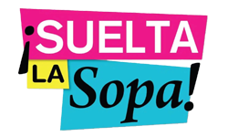
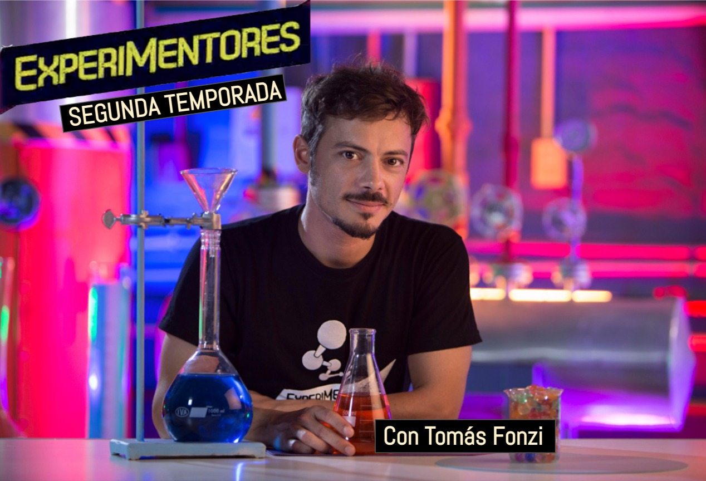
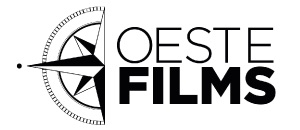
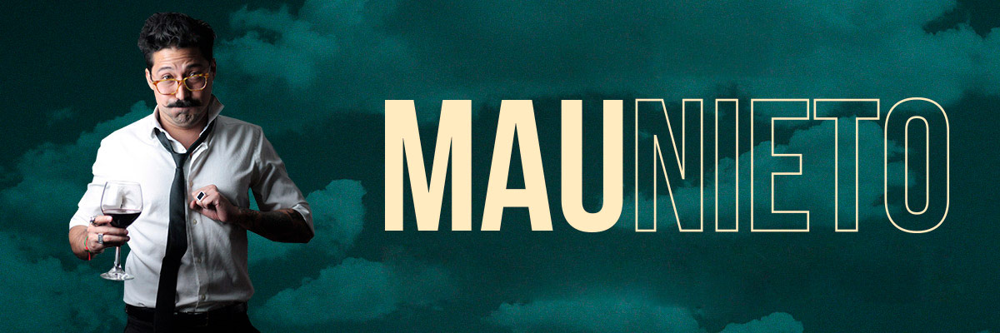

<!-- Origen: https://sinapsisproduccion.com/en/consultancy/ -->
<!-- Título de la página: Consultancy - Sinapsis Produccion -->

**ARTISTIC AND PRODUCTION CONSULTANCY

360 Consulting.

Production Processes / Efficiency / Content and Programming (2019/2020)

Content consulting.

360Powwow / Telemundo (2020)

Format consulting for Prueba de Amor.

Co-production Ecuavisa / Mediapro US (2019)

Consultancy for the Presidency of Entertainment with direct impact on programming such as Despierta América and El Gordo y la Flaca (2016 / 2017).

Format consulting for Cocineros Mexicanos (2017).

Format consulting for Big Brother City TV Colombia (2012).

Consultancy for the Presidency of Entertainment with direct impact on programming such as Despierta América and El Gordo y la Flaca (2016 / 2017).

Format consulting for Cocineros Mexicanos (2017).

**CAPACITATION WORKSHOP AND CONTENT CONSULTANCY OF GENDER PERSPECTIVE AND DIVERSITY.

Director: Silvina Acosta

Content curation with gender perspective in scripts and overall content.

Capacitation and training for authors, directors and producers.

This content curation has the objective of working alongside the writing team and the production to revise scripts and apply gender perspective as well as respect of diversity in the content.

The workshop is open to screenwriters, directors and producers. It consists of three face to face or virtual encounters to offer theoretical and practical tools about gender perspective in content.

