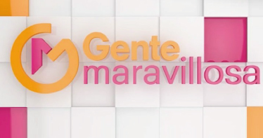

<!-- Origen: https://sinapsisproduccion.com/en/formats-and-original-content/ -->
<!-- Título de la página: Formats and original content - Sinapsis Produccion -->

[VIDEO YouTube](https://www.youtube.com/watch?v=m04lYaLcTfU)

# **LA HORA EXACTA**

Entertainment program based on footage material.

Primetime daily.

Original content by Sinapsis for El Nueve (Channel 9).

[VIDEO YouTube](https://www.youtube.com/watch?v=vMKHsfBA9eY)

# ** EL DOMO DEL DINERO**

Competition reality (physical challenges and trivia)

Daily programming on primetime for the hispanic market in the United States.

Original idea and co-development with 360Powwow and NBC Telemundo.

[VIDEO YouTube](https://www.youtube.com/watch?v=09ZDJAlEjWw)

# **DILEMA**

Journalistic and interactive game show.

Creation and integral development of format.

Versions for Argentina on Pamela a la Tarde 2019 and Animales Sueltos 2016 (América TV). Version for Peru: 2018 (Latina). Version for Bolivia: 2020/2021 (Bolivisión).

[VIDEO YouTube](https://www.youtube.com/watch?v=4g0XNhZ9-CA)

# **GENIOS EN DILEMA.TV**

Interactiva entertainment program, based around a game that was specially designed for audience participation via the app.

Creation and development of format. A hit on daily primetime alongside Dilema 2020/2021 (Bolivisión)

[VIDEO YouTube](https://www.youtube.com/watch?v=09Cy3v4ye2o)

# **COMBATE ARGENTINA**

Competition reality (physical challenges, talent and trivia).

Development of format for Argentinean version. Design of show dynamic and games.

Production, live broadcasting and general direction. 2014/2016 – El Nueve. Argentina.

[VIDEO YouTube](https://www.youtube.com/watch?v=QhnDhdu8F44)

# **#MARCHA**

Transmedia documentary project (TV series, feature film and webisodes).

The Nazi genocide from the adolescent gaze. Filmed in Poland, Israel, Argentina and the Vatican City.

Premio Argentores 2019, Best Screenplay for a TV Documentary.

Audience Favorite Award at the Jewish Film Festival (Punta del Este, Uruguay, 2019).

Declared Educational Interest by Argentina’s Honorable House of Representatives as well as other provincial organisms.

TVP Argentina / Cont.ar / Cine.ar

[VIDEO YouTube](https://www.youtube.com/watch?v=VET7HuigXFE)

# **LA FÁBRICA DEL DESEO**

Original Docu Series about life stories that challenge gender mandates and explore diverse journeys with their sexuality.

Winner of Concurso Nacional de Series Documentales 2017 (Incaa / Argentina)

Declared Interest by Argentina’s Honorable House of Representatives

Emitted simultaneously through TVP Argentina/Encuentro/Cont.ar

[VIDEO YouTube](https://www.youtube.com/watch?v=3AmORrbLbC4)

# **EL MEJOR DE LOS PEORES**

Culinary reality.

Creation, development of format and content direction.

Fox Life. Emmy nominated.

[VIDEO YouTube](https://www.youtube.com/watch?v=qOiK2enlVxs)

# **EXPERIMENTORES ARGENTINA 2 (2021)

Science program for the whole family (26×25).

Hosted by Tomás Fonzi.

Filmed in Mendoza (Argentina) in co-production with Andes Films for Paka Paka.

** PROJECTS IN DEVELOPMENT **

# **GENTE MARAVILLOSA

The hit television show from Spain comes to the Americas through Sinapsis and Glowstar Media. Bigshow entertainment and emotion with hidden cameras that award solidary people and confronts discrimination.
