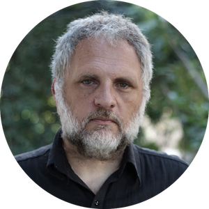

<!-- Origen: https://sinapsisproduccion.com/equipo/ -->
<!-- Título de la página: Equipo - Sinapsis Produccion -->

MARCOS GORBANDirección General

Es uno de los productores más reconocidos en Latinoamérica. Showrunner y consultor internacional de programas como Despierta América, Gordo y Flaca (Univisión, Estados Unidos), Cocineros Mexicanos (TV Azteca, México) y Suelta la Sopa (NBC Telemundo, Estados Unidos). Como consultor en gestión en programación, contenidos y procesos de producción trabajó para Latina (Perú, 2012) y Tigo Sports (Bolivia, 2019).

Desde Sinapsis Producción lidera la creación y desarrollo de formatos originales para Netflix, Disney, NBC Telemundo, Canal 9 de Argentina y los canales de Contenidos Públicos Sociedad del Estado, de Argentina, entre otros.

Antes de fundar Sinapsis Producción, fue coordinador de entretenimientos de Telefe y productor general de game, talent y reality shows como Talento Argentino, Operación Triunfo y Gran Hermano, además de liderar el desarrollo original y la producción del exitoso gameshow 3, 2, 1 a ganar (Telefé, Argentina 2010).

SILVINA ACOSTASocia Gerente

Actriz, Psicóloga, Contenidista y Directora de casting. Lidera el equipo de especialistas que asesoran y trabajan en la consultoría de contenidos con Perspectiva de Genero para canales y productoras de la Región.

Es socia de Sinapsis Producción desde la fundación de la empresa.

Ha sido parte de la concepción y el desarrollo de varios de los proyectos de la compañía, como #Marcha y La Hora Exacta.
Especialista en temáticas de género y diversidad, desarrolló la investigación, el casting y gran parte de los contenidos de La Fábrica del Deseo y consultorias para programas en desarrollo de ficción, y artistas.
 Es autora de la idea original y del desarrollo de la serie Mala Víctima. (en pre producción).

MARIO BOROVICHDirector de contenidos

Reconocido contenidista, productor y guionista. Premiado como autor de documentales.

Previo a su incorporación a Sinapsis Producción, estuvo a cargo de los contenidos de realities de Promofilm como El Conquistador del Fin del Mundo y El Show de Cándido (España), además de ser parte de éxitos como Trato Hecho y Buena Fortuna. Dirigió contenidos para formatos internacionales como El Fashion Hunter (A&E) y cámaras ocultas para República Mundialista (Univisión Deportes), entre otros proyectos. Fue, además, autor de numerosas telenovelas, comedias y series. Premiado internacionalmente como autor y director de la webserie Rumuvi.

Con Sinapsis Producción, desarrolló y dirigió los contenidos de las versiones argentinas de Combate y Experimentores, así como los formatos originales de la compañía, como Dilema y La Hora Exacta, entre otros. Junto a Gorbán y 360Powwow, desarrolló el formato original de Telemundo El Domo del Dinero.

Es, además, Lic. en Psicología y docente universitario.
